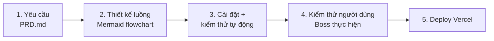

# Kế hoạch dự án – GPA Tracker

Mô hình: **Waterfall** — làm tuần tự từng giai đoạn, giai đoạn sau chỉ bắt đầu khi giai đoạn trước hoàn thành và được Boss duyệt.

---

## Giai đoạn 1 – Yêu cầu
**Đầu ra:** `PRD.md`

- [x] Viết PRD: mục tiêu, phạm vi, chức năng F1–F5, yêu cầu phi chức năng.

**Điều kiện hoàn thành:** PRD được Boss chốt.

---

## Giai đoạn 2 – Thiết kế luồng nghiệp vụ
**Đầu ra:** `docs/FLOWS.md` (flowchart cú pháp Mermaid)

- [x] Luồng tổng thể của ứng dụng (mở trang → tải dữ liệu → thao tác → lưu).
- [x] F1 – Thêm môn học (nhập → kiểm tra hợp lệ → báo lỗi / thêm vào bảng).
- [x] F2 – Quy đổi điểm (điểm hệ 10 → điểm chữ → hệ 4).
- [x] F3 – Tính GPA và xếp loại (kể cả trường hợp chưa có môn).
- [x] F4 – Sửa / xoá môn học (có bước xác nhận khi xoá).
- [x] F5 – Lưu / tải dữ liệu (kể cả dữ liệu hỏng) và "Xoá tất cả".
- [x] Boss duyệt các flowchart.

**Điều kiện hoàn thành:** Đủ flowchart cho F1–F5, Boss duyệt.

---

## Giai đoạn 3 – Cài đặt và kiểm thử tự động
**Đầu ra:** Mã nguồn + unit test (Vitest) chạy xanh

- [x] Khởi tạo dự án Vite + Vitest, cập nhật mục Commands trong `CLAUDE.md`.
- [x] F1 – Thêm môn học + test kiểm tra dữ liệu.
- [x] F2 – Quy đổi điểm + test các ngưỡng điểm (8.4 / 8.5, 3.9 / 4.0…).
- [ ] F3 – Tính GPA, xếp loại + test.
- [ ] F4 – Sửa / xoá môn học + test.
- [ ] F5 – Lưu localStorage, xử lý dữ liệu hỏng + test.
- [ ] Giao diện responsive (≥ 360px), toàn bộ tiếng Việt.
- [ ] Cập nhật bảng trạng thái mục 4 trong `PRD.md`.

**Điều kiện hoàn thành:** Đủ F1–F5, toàn bộ test đạt, `npm run build` thành công.

---

## Giai đoạn 4 – Kiểm thử người dùng (Boss thực hiện)
**Đầu ra:** Checklist kiểm thử + danh sách lỗi đã sửa

- [ ] Claude chuẩn bị checklist kiểm thử theo từng chức năng.
- [ ] Boss chạy thử trên máy tính và điện thoại.
- [ ] Sửa các lỗi Boss báo, chạy lại test tự động.
- [ ] Boss xác nhận đạt.

**Điều kiện hoàn thành:** Boss duyệt nghiệm thu.

---

## Giai đoạn 5 – Deploy lên Vercel
**Đầu ra:** URL công khai

- [ ] Cấu hình và deploy lên Vercel.
- [ ] Kiểm tra nhanh trên URL thật.
- [ ] Ghi URL vào `STATUS.md`.

**Điều kiện hoàn thành:** Ứng dụng chạy ổn định trên URL công khai.
