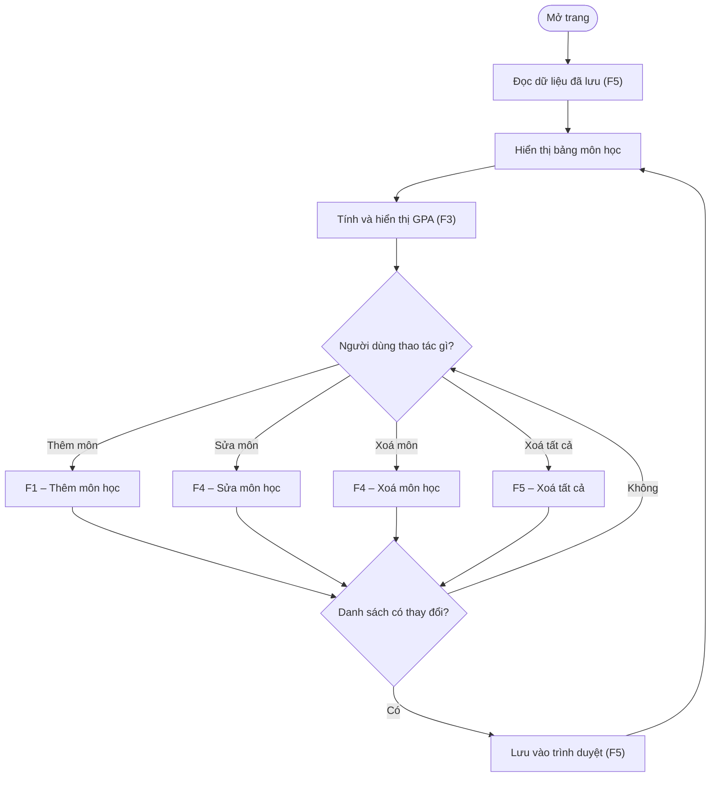
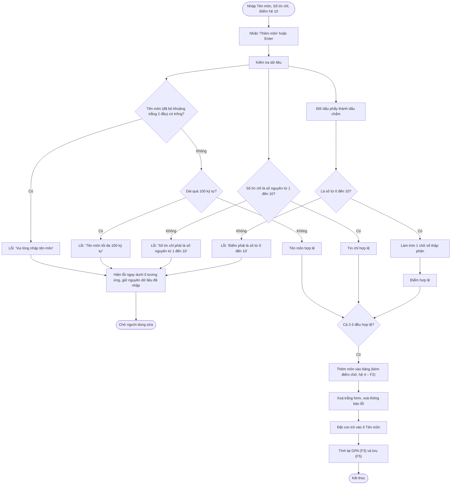
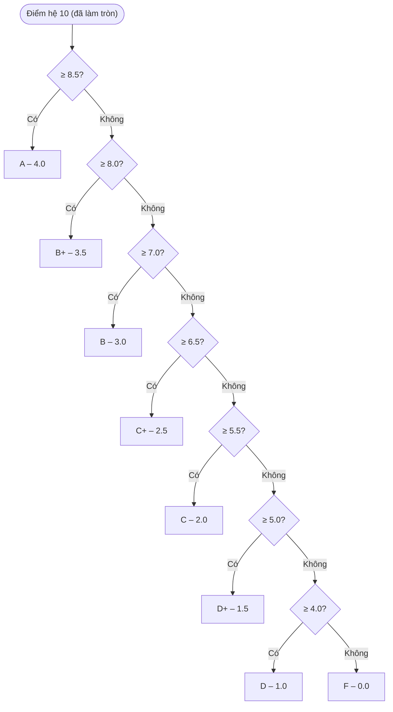
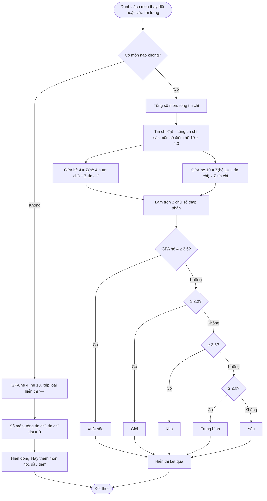
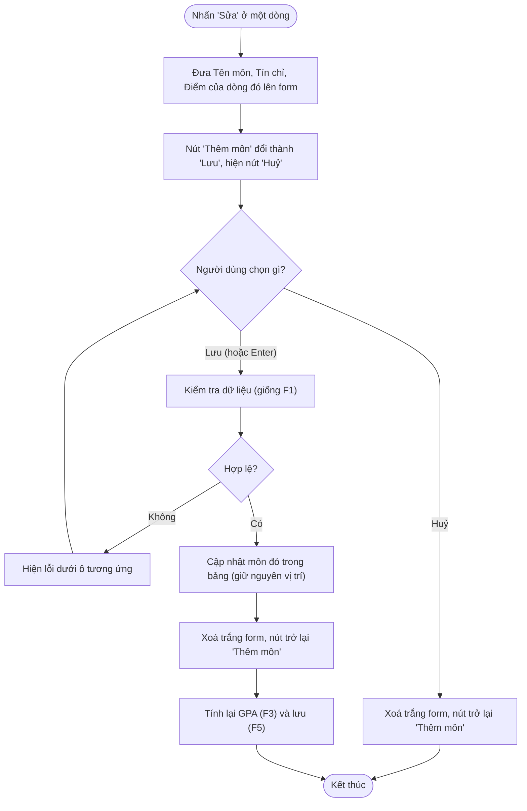
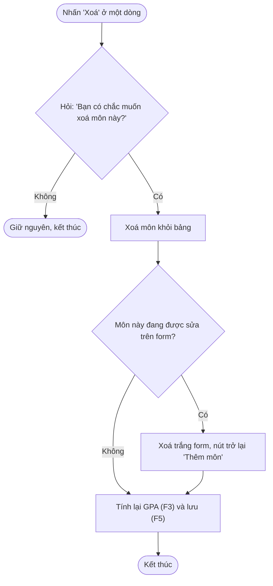
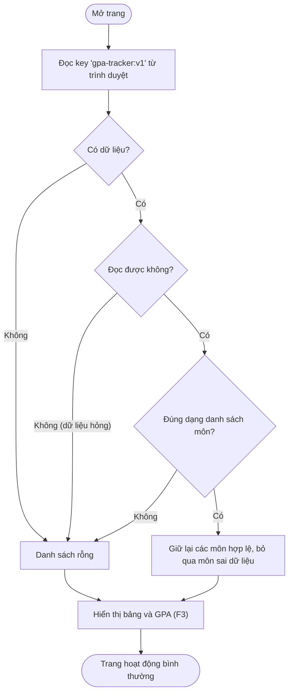
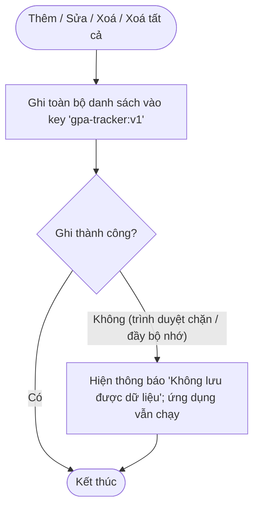
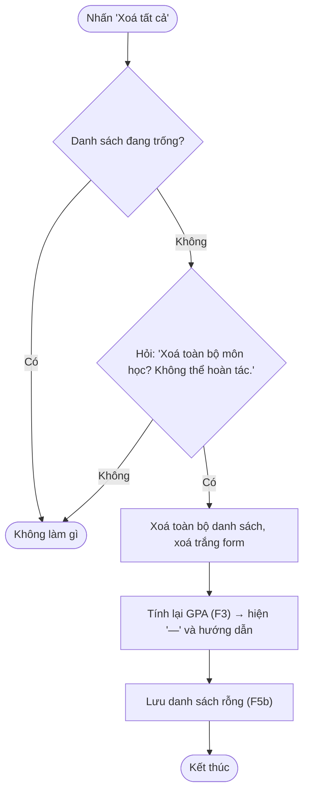

# Luồng nghiệp vụ – GPA Tracker

Tài liệu giai đoạn 2 (Waterfall). Mỗi flowchart bám theo `PRD.md`. Các điểm PRD chưa nói rõ được ghi ở mục **Giả định** cuối tài liệu để Boss duyệt.

---

## 0. Luồng tổng thể

---

## F1. Thêm môn học

---

## F2. Quy đổi điểm

Đầu vào là điểm hệ 10 **đã làm tròn 1 chữ số** (ví dụ 8,45 → 8.5 → A).

---

## F3. Tính GPA và xếp loại

---

## F4. Sửa và xoá môn học

### F4a. Sửa

### F4b. Xoá

---

## F5. Lưu và tải dữ liệu

### F5a. Tải dữ liệu khi mở trang

### F5b. Lưu khi có thay đổi

### F5c. Xoá tất cả

---

## Giả định (PRD chưa nói rõ – Boss đã duyệt 2026-10-07)

1. **Nút "Huỷ" khi sửa (F4a):** thêm nút Huỷ để thoát chế độ sửa mà không lưu.
2. **Xoá môn đang sửa (F4b):** form được xoá trắng và trở về chế độ "Thêm môn".
3. **Dữ liệu lưu bị hỏng một phần (F5a):** giữ các môn hợp lệ, bỏ qua môn sai, thay vì bỏ cả danh sách.
4. **Không lưu được (F5b):** hiện thông báo nhẹ, ứng dụng vẫn dùng bình thường.
5. **"Xoá tất cả" khi danh sách trống (F5c):** nút bị vô hiệu, không hỏi xác nhận.
6. **Hiển thị lỗi (F1):** kiểm tra cả 3 ô cùng lúc và hiện tất cả lỗi một lượt.
